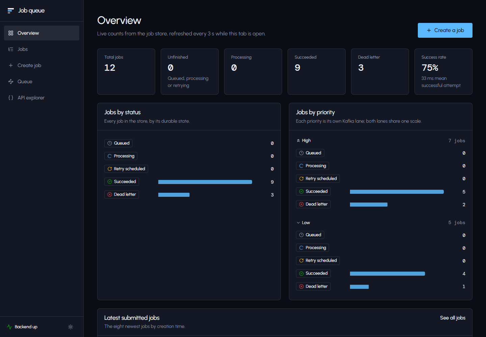
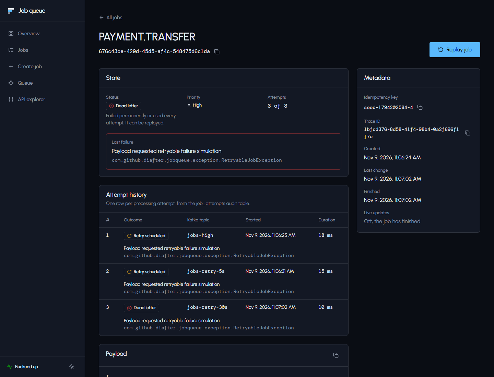
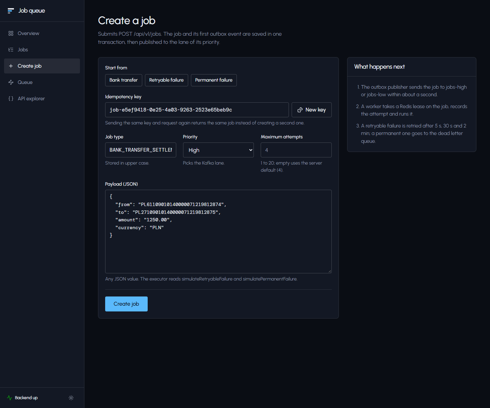
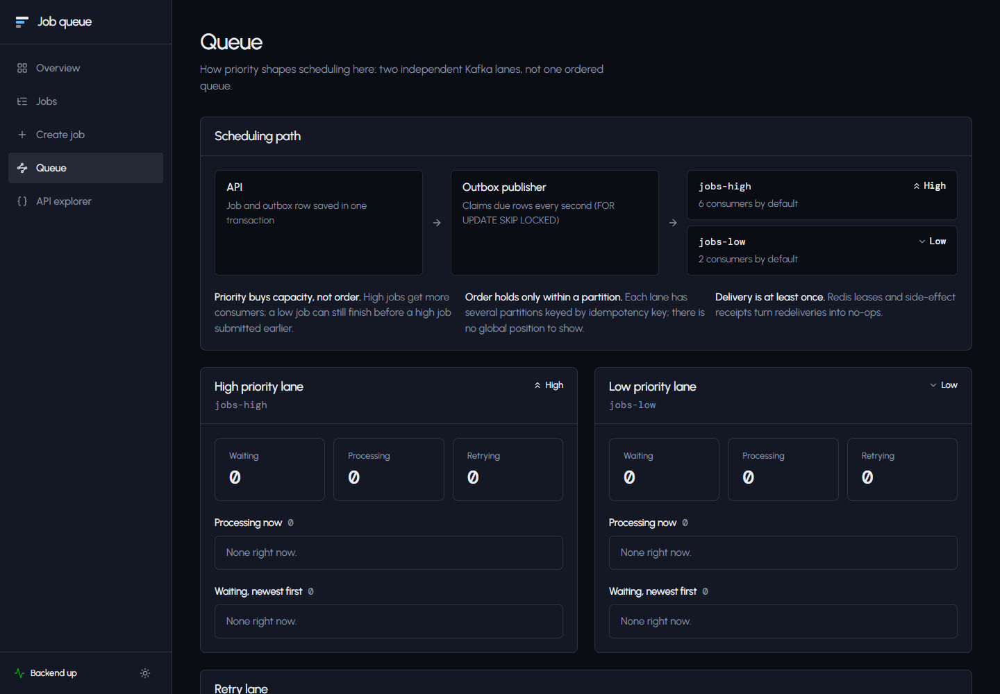
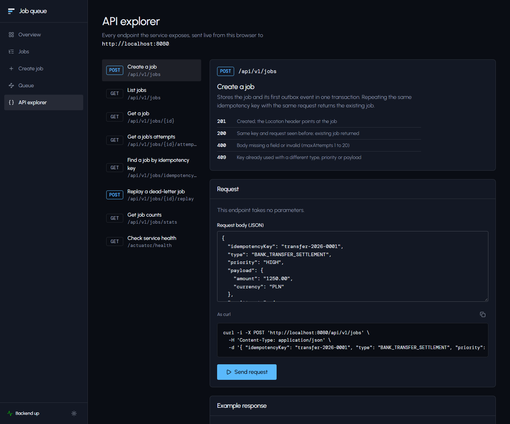
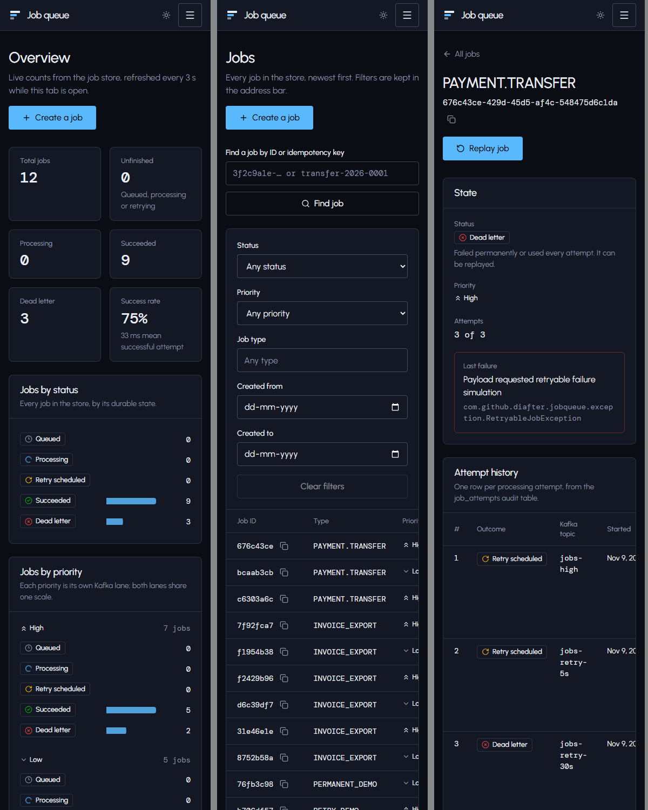
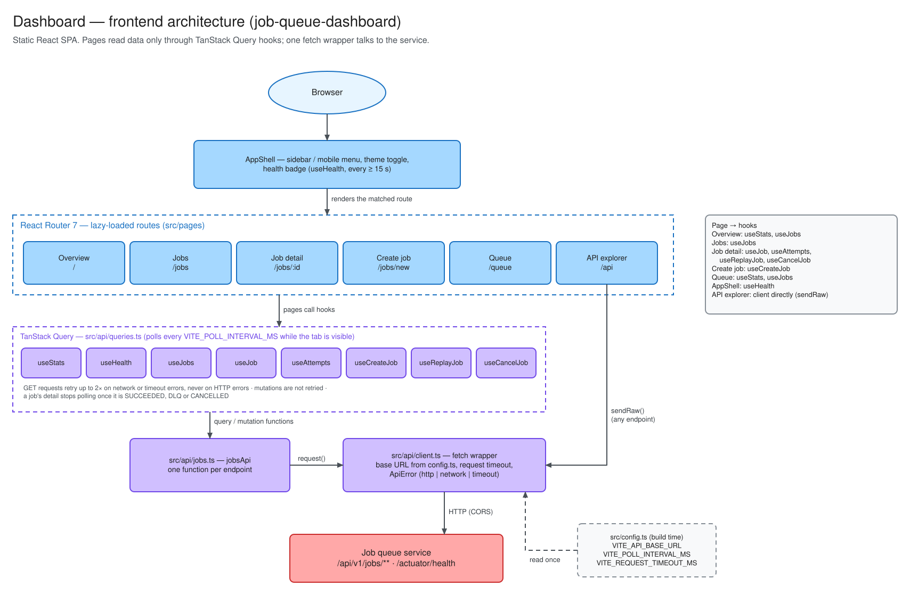

# Job queue dashboard

A web dashboard for the [Distributed Priority Job Queue](https://github.com/harsh11101/Job-Queue) service. It shows live job counts, lets you browse, filter and inspect jobs with their attempt history, create jobs, replay dead-letter jobs, and call every API endpoint from the browser.

It is a static single-page app. Everything it shows comes from the service's REST API and `/actuator/health`; it has no backend of its own.



## Pages

| Page | Path | What it does |
| --- | --- | --- |
| Overview | `/` | Totals, success rate, mean attempt time, jobs by status and by priority, latest jobs |
| Jobs | `/jobs` | Paged list, newest first. Filter by status, priority, type and creation date (kept in the URL). Find a job by ID or idempotency key |
| Job detail | `/jobs/:id` | State, last failure, attempt history, payload, result, metadata. **Cancel** for queued, retrying and dead-letter jobs, and **Replay** for dead-letter jobs, each behind a confirmation dialog. Refreshes until the job finishes |
| Create job | `/jobs/new` | Form with presets for a normal job, a retryable failure and a permanent failure |
| Queue | `/queue` | The two priority lanes and the retry lane, with what is waiting or running in each |
| API explorer | `/api` | Every endpoint with its status codes, an editable request, a `curl` equivalent and the live response |

| Job detail | Create job |
| --- | --- |
|  |  |
| **Queue** | **API explorer** |
|  |  |

The layout works down to phone width (390 px below); wide tables scroll inside their cards. The theme starts dark; the button in the sidebar switches to light and the choice is remembered in the browser.



## Local setup

### Prerequisites

- Node.js **20.19+ or 22.12+** (required by Vite 8) and npm
- The backend running on `http://localhost:8080`. See [the backend README](../distributed-priority-job-queue/README.md#local-setup); the quickest way is `docker compose --profile app up -d --build` in that folder.

### Run

```bash
cp .env.example .env.local
npm ci
npm run dev
```

Open <http://localhost:5173>. The sidebar badge should read **Backend up**.

### Configuration

All settings are Vite build-time variables. Set them in `.env.local` for development, or in the hosting provider for production builds.

| Variable | Default | Purpose |
| --- | --- | --- |
| `VITE_API_BASE_URL` | empty (same origin) | Backend origin without a trailing slash, e.g. `http://localhost:8080` |
| `VITE_POLL_INTERVAL_MS` | `5000` | How often live views refresh while the tab is visible |
| `VITE_REQUEST_TIMEOUT_MS` | `10000` | Every request is aborted after this long |

Leave `VITE_API_BASE_URL` empty when a reverse proxy serves the dashboard and routes `/api` and `/actuator` to the backend on the same origin.

### Troubleshooting

| Symptom | Cause and fix |
| --- | --- |
| Badge says **Backend unreachable**, but `curl http://localhost:8080/actuator/health` works | The browser is blocked by CORS. The backend allows only the origins in `CORS_ALLOWED_ORIGINS` (default `http://localhost:5173`). Add your origin, e.g. `http://localhost:4173` for `npm run preview`, and restart the backend |
| Badge says **Backend unreachable** and `curl` fails too | The backend is not running, or `VITE_API_BASE_URL` points elsewhere. Restart `npm run dev` after editing `.env.local` |
| `npm ci` or `vite` fails with an engine error | Node is older than 20.19; upgrade it |
| Port 5173 is taken | `npm run dev -- --port 5174`, and add `http://localhost:5174` to `CORS_ALLOWED_ORIGINS` |

## Testing

```bash
npm test            # Vitest + Testing Library, 21 tests; fetch is stubbed, no backend needed
npm run typecheck   # tsc -b
npm run lint        # oxlint
npm run build       # typecheck + production bundle in dist/
npm run preview     # serve dist/ on http://localhost:4173
```

- `src/test/lib.test.ts`: API error mapping and unreachable-backend handling, URL filter parsing, stats summary, create-form validation matching the backend's rules, API explorer path building.
- `src/test/pages.test.tsx`: renders real routes against stubbed responses. Covers overview figures and the backend-down state; jobs list empty state, filters and paging, lookup by key; create-job field errors, success and idempotency conflict; job detail with attempts, not found, and replay only after confirmation.

**Manual check against the real backend:** with the backend and `npm run dev` running, open **Create job** and use each preset:

- **Bank transfer** turns *Succeeded* within about a second.
- **Retryable failure** (default 4 attempts) goes through *Retry scheduled* after 5 s, 30 s and 2 min, then *Dead letter*, about 2.5 minutes in all.
- **Permanent failure** goes to *Dead letter* at once. Its page then offers **Replay job** and **Cancel job**; after a cancel the job shows *Cancelled* and Replay is gone.

## Deployment

`npm run build` produces a static site in `dist/`. `vercel.json` configures Vercel: the Vite framework preset plus a rewrite of every path to `index.html`, so client routes load directly. Any static host works with the same rewrite.

Set `VITE_API_BASE_URL` to the public backend URL at build time, and add the dashboard's origin to the backend's `CORS_ALLOWED_ORIGINS`.

## Architecture



Pages never call `fetch` themselves: they read and change data through TanStack Query hooks, which call `jobsApi`, which goes through the one fetch wrapper in `src/api/client.ts`. The API explorer is the exception: it sends whatever request you build straight through the client. To change the diagram, edit [`docs/architecture/dashboard-architecture.excalidraw`](docs/architecture/dashboard-architecture.excalidraw) at [excalidraw.com](https://excalidraw.com) or in the VS Code Excalidraw extension and export it over the `.svg` (*Export image → SVG*, with *Background* on). Diagrams of the service itself are in the [backend README](../distributed-priority-job-queue/README.md#design-diagrams).

## Stack and layout

React 19, TypeScript, Vite 8, Tailwind CSS 4, TanStack Query (polling, caching, retries), React Router 7 (lazy-loaded routes), Base UI dialog, Sonner toasts, lucide icons. Tests use Vitest, Testing Library and jsdom; lint uses oxlint.

```text
src/
  api/         fetch client with timeout and typed errors, endpoint functions, query hooks, response types
  components/  app shell, panels, badges, charts, form controls, loading/empty/error states
  lib/         formatting, job status metadata, filter <-> URL mapping, stats helpers, theme
  pages/       one module per route
  test/        Vitest suites and render helpers
  config.ts    the only place that reads environment variables
```
